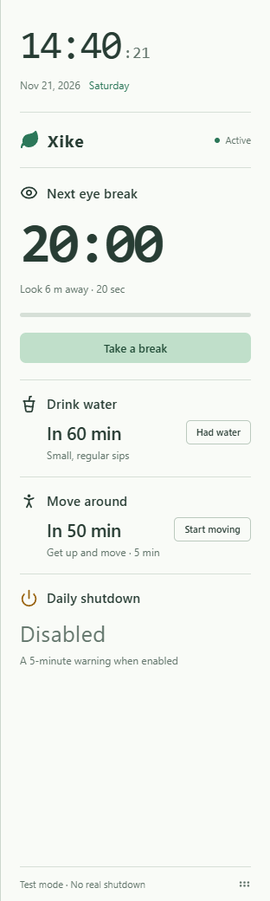
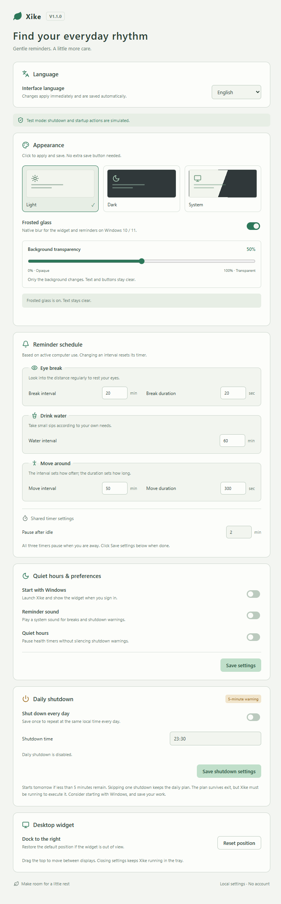
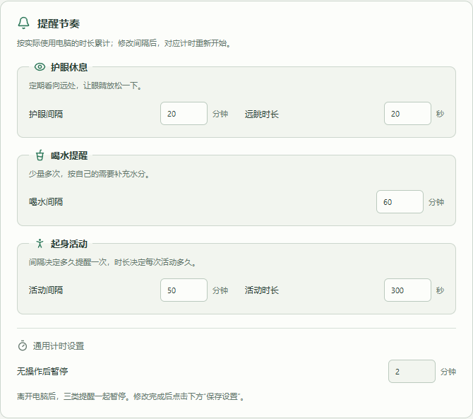
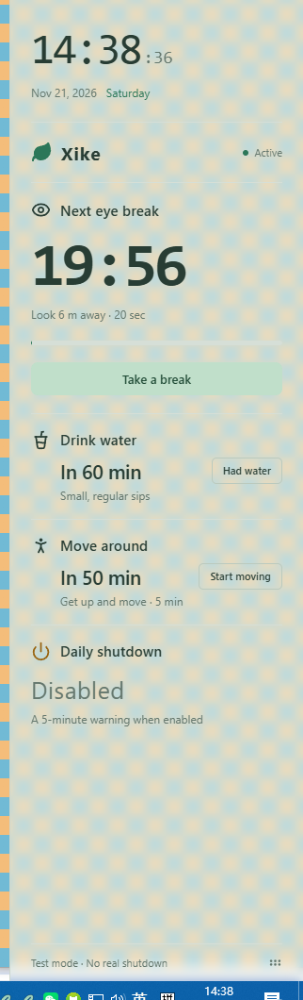

[简体中文](README.md) | **English**

# Xike (息刻)

A Windows desktop companion for eye breaks, drinking water, movement, and a daily shutdown routine.

**Current version: V1.2.0**

**Status: A working Windows desktop application with an installer and an unpacked build.**

Source: [ldundefined/xike](https://github.com/ldundefined/xike). Download Windows installers from [GitHub Releases](https://github.com/ldundefined/xike/releases). Dependencies, build outputs, and local tools are excluded from source control.

## Install and use

Supported platform: Windows 10/11 x64. Outputs are placed in `release/v1.2.0/`, isolating each version so a new build does not clean an older running build:

- `Xike-Setup-1.2.0.exe`: run the installation wizard, then launch the app.
- `win-unpacked/息刻.exe`: the unpacked executable. Keep the entire `win-unpacked` directory; copying only the executable will not work.

The widget docks to the right edge of the selected display. It stays 312px wide and fills the available desktop height without covering the taskbar. A live clock, full date, and weekday appear at the top. Drag the top area to another display to dock there. Click the status beside the brand name to pause or resume health reminders.

Double-click the leaf icon in the system tray to open settings, or right-click it and select **Open settings**. Windows may place the icon in the hidden tray icons area. Settings include language, appearance, frosted glass, reminder intervals, break durations, idle detection, sound, quiet hours, startup, and daily shutdown.

### Language

**English is the default language.** At the top of settings, select **Language → Interface language → 简体中文** to switch to Simplified Chinese. Select **English** to switch back. Changes apply immediately and are saved automatically; no restart is required.

The widget, settings, reminder windows, tray menu, status and error messages, dates, and weekdays share the same language. Switching languages does not reset reminder timers, appearance preferences, or the daily shutdown plan. Existing configurations without a language field receive the English default.

### Background transparency

The **Frosted glass** switch applies to the widget and reminder windows. Its **Background transparency** slider ranges from **0% to 100%**, with a default of **50%**. Lower values make the background more opaque; higher values reveal more of the blurred desktop. Text and buttons remain opaque. Changes are applied and saved immediately. The settings window keeps a solid background for readability.

### Reminders over full-screen windows

**Keep reminders above full-screen apps** is enabled by default under **Quiet hours & preferences**. Click **Save settings** after changing it. Reminders appear on the display containing the cursor, use a higher always-on-top level, and refresh their position in the window stacking order while visible. The desktop sidebar keeps its ordinary window behavior.

Automatic health reminders and shutdown warnings do not take keyboard focus. Explicitly opening a reminder through the tray may focus it. A dismissed reminder is not reopened by topmost maintenance.

This supports ordinary and borderless full-screen windows. **Exclusive full-screen games cannot be guaranteed:** use borderless/windowed full-screen mode when reminders must be visible. Xike does not inject a game overlay or force a game to the desktop. See [Electron window levels](https://www.electronjs.org/docs/latest/api/browser-window/).

### Startup and shutdown

**Start with Windows is off by default.** Enable it in settings and click **Save settings**. Real startup registration is available only in the installed build, not development mode.

Closing settings keeps Xike running in the tray. To exit, use **Quit Xike** in the tray menu. The daily shutdown plan remains saved across exits and restarts, but **Xike must be running at the scheduled time**. It does not install a background service or execute shutdown tasks after it exits.

Enable **Shut down every day**, choose a **Shutdown time**, and click **Save shutdown settings**. The same local time repeats daily. **Skip this shutdown** skips only the next occurrence; later daily occurrences remain scheduled. Disable the switch and save to turn off the plan entirely.

### Local configuration

Settings are stored in `settings.json` under Electron's current-user data directory, outside the source tree and installer. Corrupt settings are backed up before restoring defaults and disabling shutdown. Reminder progress is not persisted across process restarts; restarting begins full reminder intervals again.

The configuration uses schema 2. Migration preserves existing reminder settings and display position, and fills missing appearance, language, and transparency defaults. An old one-off shutdown booking is **not** silently converted to a recurring daily plan; enable daily shutdown explicitly after upgrading from that version.

### Real application screenshots

These screenshots come from actual Electron windows. Shutdown and startup actions are simulated in UI tests, and the displayed schedules are test data.







Windows 10 composition verification uses a controlled checkerboard window behind the widget. The pattern remains sharp outside the widget and becomes blurred through its background:



## Development and builds

Environment: Node.js 24 LTS, pnpm 11.25.0, Windows x64. Dependency resolution is locked by `pnpm-lock.yaml`.

```powershell
pnpm install --frozen-lockfile
# If the Electron binary has not been downloaded after the first install:
node node_modules/electron/install.js
pnpm dev
```

Vite serves the renderer during development. Restart the development command after changing the main process or preload code.

```powershell
pnpm check       # TypeScript checks
pnpm test        # Domain, storage, and i18n tests
pnpm test:ui     # Build and test real Electron windows; simulate shutdown/startup
pnpm test:fullscreen # Windows fullscreen, native z-order, focus, and dismissal checks
node scripts/glass-test.mjs # Verify native glass on an interactive Windows desktop
pnpm build       # Compile into dist/
pnpm start       # Run the compiled application
pnpm run pack    # Create release/v<version>/win-unpacked/; do not shorten to pnpm pack
pnpm run dist    # Build the NSIS installer
```

UI tests use an isolated temporary profile and do not read or change normal user settings. They never perform a real shutdown or register real startup entries. `XIKE_TEST=1` is for development tests only.

Native composition is included in the normal UI path. For an isolated UI run that skips native backdrop calls, set `XIKE_TEST_NO_NATIVE=1` alongside test mode. This does not disable frosted glass in production. `scripts/glass-test.mjs` separately verifies the real desktop effect.

## Background

Long computer sessions make it easy to forget breaks, water, and movement. Xike provides quiet, visible reminders to help users maintain a comfortable routine. Daily shutdown warnings help users finish their computer session on time.

The app runs locally on Windows, supports startup and tray operation, and requires no account or cloud service.

## Product and features

### Desktop widget

- Fixed 312px width, docked to the selected display's right edge and full available height; adapts to work-area and display changes.
- Clock, date, and weekday at the top, followed by status and reminders.
- Ordinary work windows can cover it. Always-on-top mode is a possible future option.
- Shows eye-break, water, and movement countdowns, plus the daily shutdown time and next occurrence.
- Offers **Take a break**, **Had water**, **Start moving**, and **Skip this shutdown**.
- No daily statistics, navigation sidebar, or settings button inside the widget.
- The system tray provides settings, visibility, pause/resume, current reminders, and exit actions.

### Reminder schedule

The settings area contains three bordered groups: **Eye break** puts its interval and duration together; **Drink water** contains the water interval; **Move around** puts the movement interval and duration together. Shared idle-pause behavior appears separately below them. Every input retains its unit.

Appearance and language remain independent settings sections. Theme, glass, transparency, and language changes apply and save immediately. Reminder and general preference edits use **Save settings**.

| Reminder | Initial default | Actions |
| --- | --- | --- |
| Eye break | After 20 minutes of computer use, look about 6 meters away for at least 20 seconds | Countdown, start now, snooze |
| Movement | After 50 minutes of computer use, move for about 5 minutes | Countdown, start moving, snooze |
| Water | A gentle reminder every 60 minutes | Countdown, confirm water, snooze |

These are adjustable product defaults, not universal health requirements. The water interval is a configurable reminder, not a medically prescribed drinking frequency or quantity.

- Configure intervals, quiet hours, and startup in settings.
- Health timers pause when the user is away, the screen locks, or the computer sleeps.
- Resume without sending a backlog of reminders accumulated during absence.
- Simultaneous health reminders are presented sequentially rather than stacking popups.
- Hiding the widget or closing settings does not stop the scheduler. Quitting the app does.
- Completing or ending a break resets the next countdown to that reminder's configured interval. Confirming water restores the water interval. Only explicitly choosing **Remind me in 5 minutes** temporarily delays that occurrence; it never changes the saved interval.

### Daily shutdown

- Settings provide an enable switch, a fixed local time, and a save button instead of a one-off date picker.
- Save once to repeat daily. The plan and consumed occurrence dates persist across exit and restart. Daily shutdown is disabled by default.
- A separate countdown appears **5 minutes before shutdown**, asks users to save their work, and offers **Skip this shutdown**.
- Skip the next occurrence from the widget, tray, or warning window without disabling the daily plan. Turn off the switch in settings to disable the plan completely.
- If today's time has passed or less than 5 minutes remain when configuring a plan, start tomorrow.
- Compute occurrences from the local calendar, including midnight and month boundaries. Consumed dates help prevent duplicate execution after restart or a clock rollback.
- Health reminder pause and quiet hours do not silence shutdown warnings. Xike must remain running; startup is recommended for a recurring routine.
- Missed occurrences are not executed after wake or relaunch. Resume with the next eligible occurrence; skip an occurrence if a full warning cannot be provided.
- Applications are not forcibly closed. Windows or an application may block shutdown because of unsaved work. A rejected shutdown is not immediately retried.

## Design

### Visual direction

The interface is minimal, with **Light**, **Dark**, and **System** themes. Light uses a soft gray-white background by default. Dark uses a lighter charcoal rather than near-black. Green identifies primary actions and amber identifies shutdown warnings. Countdowns carry the main visual emphasis.

Clicking a theme card or glass switch applies and persists it immediately across windows. System mode follows native theme updates. A shared i18n layer supplies the renderer and main process with English and Simplified Chinese text, interpolation, and localized date formats.

Frosted glass affects only the widget and reminder background. Text and controls remain fully opaque, and the settings form uses a solid surface.

- **Windows 10 1803 / build 17134 and later:** Koffi calls `SetWindowCompositionAttribute` Blur Behind, using a transparent frameless window and a tinted background layer. Blur Behind avoids the inactive-window opacity behavior of Win10 Acrylic.
- **Windows 11 22H2 / build 22621 and later:** Electron's system Acrylic backdrop API. Earlier Windows 11 versions use the composition compatibility layer.
- High-contrast mode, reduced transparency, or native call failures cause a solid fallback with an explanation. The Windows 10 composition interface is undocumented and requires compatibility checks for future system changes.
- Native blur was verified on Windows 10 build 19045 through desktop captures and pixel comparisons. The Windows 11 path still requires manual verification on that platform.

References: [Windows composition example](https://github.com/sylveon/windows-swca), [Koffi pointers](https://koffi.dev/pointers), [Electron background material](https://www.electronjs.org/docs/latest/api/browser-window), [native theme](https://www.electronjs.org/docs/latest/api/native-theme).

Widget content from top to bottom:

1. Live clock, full date, and weekday.
2. Brand and running status.
3. Eye-break countdown, guidance, and start button.
4. Water countdown and confirmation.
5. Movement countdown and start button.
6. Daily shutdown time, next occurrence, and skip button.
7. Automatic-pause status.

Settings are opened from the tray so the widget remains focused. Values in design concepts and test screenshots are examples. The final widget has no daily statistics.

### Desktop behavior

Desktop residence means the process keeps running and displays a right-side component. Embedding behind desktop icons and remaining visible through **Win+D** requires additional native integration and compatibility work. This version uses ordinary window behavior and does not claim desktop-icon-layer embedding.

## Architecture

**TypeScript + Electron + React** keeps UI and core logic in one language, reducing cross-language maintenance. Electron's package size and memory overhead are accepted tradeoffs.

| Layer | Responsibility |
| --- | --- |
| React renderer | Widget, settings, health reminders, shutdown warning |
| Preload bridge | Restricted, typed IPC operations |
| Electron main process | Lifecycle, single instance, windows, tray, startup, service orchestration |
| Domain modules | Health timers, pause/resume, daily shutdown, appearance capabilities, validation |
| System adapters | Idle/lock/sleep events, login startup, Windows shutdown, composition |
| Local storage | JSON settings and consumed dates, atomic writes, schema 1→2 migration, corrupt-file backups |
| Shared i18n | Built-in English/Chinese messages, interpolation, and date formatting in `src/shared/i18n.ts` |

### Implementation principles

- The main process schedules reminders and shutdown; React timers do not execute system actions.
- Health reminders accumulate active use, while shutdown uses local calendar time. Detect sleep and clock jumps to avoid unexpected actions on resume.
- The recurring plan is separate from warning, skipped, missed, and executed occurrences. Persist consumed dates.
- Domain logic has no direct Electron, filesystem, registry, or shutdown dependencies; adapters handle side effects.
- Context isolation is enabled and renderer Node integration is disabled. The main process validates IPC inputs and does not expose arbitrary command execution.
- Local JSON is sufficient; no database, Windows service, or cloud backend is required.
- Exit stops timers and releases windows/tray resources while retaining the daily plan. Relaunch calculates the next occurrence instead of executing missed ones.
- Tests substitute shutdown and startup adapters; automated tests must not perform either real action.
- Language and transparency changes preserve timers and daily plans. New localization fields are added to old configurations without discarding existing preferences.

### Source layout

```text
src/
  main/           Electron lifecycle, windows, and tray
  preload/        Typed IPC bridge
  renderer/       React widget, settings, and reminders
  domain/         Scheduling, daily shutdown, appearance, and validation
  platform/       Windows adapters
  storage/        JSON persistence and migration
  shared/         Types, IPC protocol, and i18n
tests/            Domain, storage, and localization tests
scripts/          Builds, development, icons, and UI/desktop verification
assets/           Application and tray icons
docs/screenshots/ Actual application captures
```

### Validation and limits

Validation covers pause/resume, simultaneous reminders, lock/sleep handling, five-minute warnings, skipping and disabling a plan, calendar boundaries, daily repetition, restart recovery, language persistence, translation placeholders, and transparency values.

- TypeScript checks and automated domain, storage, and i18n tests cover defaults, migration, translations, date formats, and unchanged schedules after language changes.
- Real Electron UI tests verify English by default, immediate Chinese/English switching, translated reminder windows and native titles, theme changes, settings, daily shutdown, and restart persistence.
- Native blur verification compares actual desktop captures against a controlled checkerboard; a renderer screenshot alone does not prove desktop blur.
- Widget geometry and the compact 560px layout are verified, including the clock and shutdown controls.
- Real system shutdown, Windows login startup, full system lock/sleep flows, and the Windows 11 native backdrop require manual acceptance in the corresponding environment.
- The widget can be covered by normal windows and follows ordinary **Win+D** behavior.
- Full-screen reminder verification uses an actual Windows full-screen fixture and native z-order inspection, including competing topmost windows, focus preservation, dismissal, and opt-out. It does not establish compatibility with every game or DirectX exclusive full-screen mode.
- Health reminders pause during quiet hours or absence, then resume in sequence.
- The installer is unsigned, and there is no automatic update service.

## Sources for default reminder intervals

- [American Academy of Ophthalmology: computer use and eye strain](https://www.aao.org/eye-health/tips-prevention/computer-usage): the 20-20-20 suggestion.
- [HSE: breaks during display-screen work](https://www.hse.gov.uk/msd/dse/work-routine.htm): short, frequent breaks, such as 5–10 minutes per hour.
- [NHS: water, drinks, and hydration](https://www.nhs.uk/live-well/eat-well/food-guidelines-and-food-labels/water-drinks-nutrition/): general hydration information, not a fixed hourly drinking requirement.

## Version policy

Use `Vmajor.feature.fix`, starting at **V0.0.1**.

- New functionality increments the middle component and resets the last: `V0.0.1 → V0.1.0`.
- Bug fixes increment the last component: `V0.1.0 → V0.1.1`.
- A release containing features and fixes follows the feature increment and documents both.
- Documentation-only changes do not automatically change the application version.
- Major changes require the user's decision. **V1.1.0 was explicitly requested by the user.**
- Keep both README versions, changelogs, package metadata, and build versions consistent. Program metadata omits the `V` prefix.

## Changelog

### V1.2.0 · 2026-11-21

- Add the enabled-by-default full-screen reminder preference. Reminder windows use the higher `screen-saver` level and maintain their z-order while visible.
- Show reminders on the cursor's display and reposition/reassert topmost behavior when reusing a window.
- Preserve keyboard focus for automatic health reminders and shutdown warnings; tray-requested reminders may focus explicitly.
- Keep dismissed reminders hidden and leave the sidebar's window level unchanged.
- Add a Windows fullscreen/native z-order integration test and document the exclusive full-screen limitation.

### V1.1.1 · 2026-11-21

- Fix ending an eye or movement break resetting the next reminder to a hard-coded five minutes. It now uses the corresponding configured interval.
- Keep the explicit five-minute snooze temporary. Completing or ending the subsequent break restores the custom cycle without changing preferences.
- Add multi-cycle eye/movement/water regression checks, changes made during a break, and a real-window assertion for the countdown after ending a break. The automated suite now contains 40 tests.

### V1.1.0 · 2026-11-21

- Set the version to V1.1.0 as requested; add built-in English and Simplified Chinese, with English as the default.
- Add an instant, persistent language selector at the top of settings. Translate the widget, settings, reminders, tray, status/errors, and calendar formats.
- Preserve health timers, appearance, and daily shutdown plans when switching languages; migrate missing language preferences to English.
- Add a 0–100% background transparency slider below the glass switch, defaulting to 50%; apply and save changes while preserving opaque text and controls.
- Add this English README and a language switch at the top of both documents.
- Add localization coverage, interpolation, persistence, and transparency validation tests.
- Put build outputs in separate version directories to avoid overwriting a running older unpacked build.

### V0.4.0 · 2026-11-21

- Group eye, water, and movement preferences in separate bordered sections; keep each interval next to its duration.
- Separate shared idle-pause behavior and clarify interval versus duration.
- Extend the right-docked 312px widget to full available height and add the live clock/date/weekday at the top.
- Retain instant themes and Windows 10 glass; update screenshots, documentation, builds, and UI regression checks.

### V0.3.0 · 2026-11-21

- Fix theme selection requiring a separate save action: theme and glass changes now apply and persist immediately.
- Replace hidden theme inputs with full clickable cards.
- Add Windows 10 native blur and fix opaque widget interiors by using transparent windows.
- Keep settings solid for readability; verify background visibility and blur using desktop captures and pixels.
- Verify actual theme color changes, restart persistence, and daily shutdown behavior.

### V0.2.0 · 2026-11-21

- Add Light, Dark, and System themes with immediate synchronization after saving, defaulting to Light.
- Add native Acrylic capability checks and solid fallback for unsupported configurations.
- Replace one-off shutdown with a persistent daily switch/time plan, plus skipping and disabling.
- Migrate configuration to schema 2, preserving reminders and position without automatically converting one-off bookings.
- Pass 30 domain/storage tests and real Electron UI checks; update screenshots and builds.

### V0.1.0 · 2026-11-21

- Implement the initial TypeScript/Electron/React app and Windows x64 packaging.
- Add the right-side dark widget, tray/settings, single-instance behavior, drag/position persistence, and three health reminders.
- Add pause/snooze, idle and quiet hours, lock/sleep events, startup, sound, and a one-off shutdown with a five-minute warning.
- Implement atomic local settings, validation, backups, 19 domain/storage tests, and real Electron UI checks with simulated system side effects.

### V0.0.1 · 2026-11-20

- Document the background, architecture, and design direction.
- Choose TypeScript, Electron, and React; define the vertical right-side widget and tray-only settings.
- Plan health reminders, startup, and shutdown warnings; establish version and changelog rules.
- This was planning/documentation only, without a runnable application.
