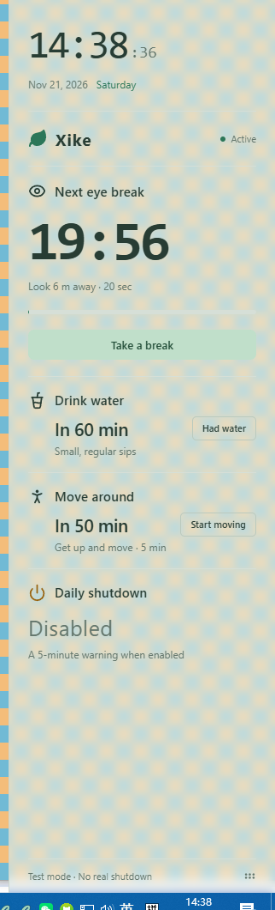
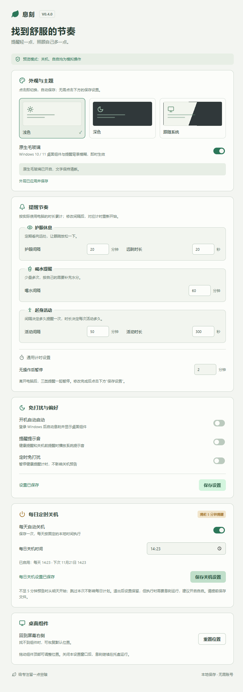
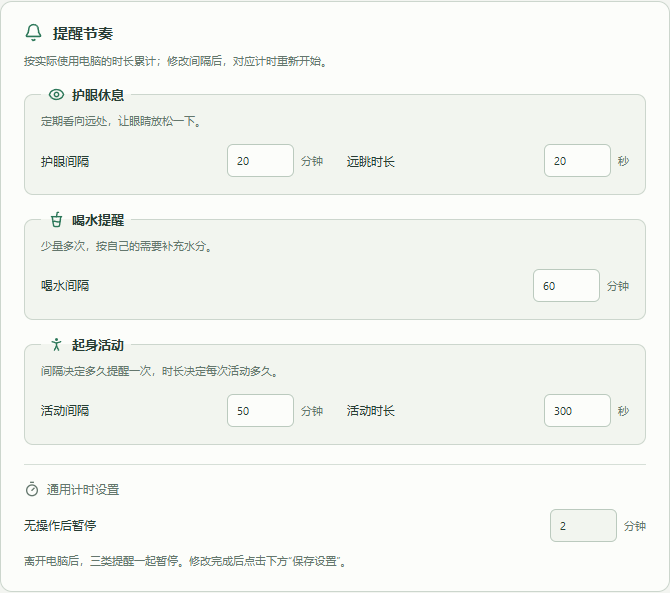

**简体中文** | [English](README.en.md)

# 息刻

Windows 桌面常驻健康提醒工具。

**当前版本：V1.1.1**
**项目阶段：首个 Windows 桌面版本已实现，可构建安装包与免安装运行目录。**

源码仓库：[ldundefined/xike](https://github.com/ldundefined/xike)。Windows 客户端安装包通过 [GitHub Releases](https://github.com/ldundefined/xike/releases) 分发，`node_modules/`、`release/` 及本地工具目录不进入源码历史。

## 安装与使用

适用于 Windows 10/11 x64。最终产物按版本放在 `release/v1.1.1/` 目录，避免新构建清理正在运行的旧版本目录：

- `Xike-Setup-1.1.1.exe`：安装版，按向导安装后运行。
- `win-unpacked/息刻.exe`：免安装运行入口，必须保留整个 `win-unpacked` 文件夹，不能只复制 exe。

启动后，组件以 312px 固定宽度贴住屏幕右边缘，高度铺满桌面可用区域，避开任务栏。最上方显示实时的时、分、秒、完整日期与星期。拖到其他显示器后，会自动贴合该显示器右侧并记住所选屏幕。点击品牌栏的运行状态可暂停或恢复健康提醒。

双击右下角系统托盘的叶子图标打开设置，或右键托盘选择“打开设置”。托盘图标可能被 Windows 收入隐藏图标区域。设置窗口包含主题与毛玻璃选项、提醒间隔、休息时长、无操作暂停时间、提示音、免打扰时段、开机自启和每日定时关机。**开机自启默认关闭，需要在设置中启用并保存；开发模式不支持真实自启。**

**应用默认英文**。双击托盘图标，进入设置顶部的 **Language → Interface language**，选择 **简体中文** 即时切换并自动保存，无需重启。也可在中文界面的“语言 → 界面语言”中切回 English。组件、设置、提醒、托盘菜单、提示消息以及日期/星期格式同步切换；已有设置缺少语言字段时补为英文，保留原提醒和每日关机计划。

毛玻璃开关下方提供 **背景透明度** 滑条，范围 **0–100%**，默认 **50%**。越低越不透明，越高越能看到被模糊的桌面；仅改变组件及提醒的背景，文字和按钮保持不透明。调整后即时生效并自动保存，关闭毛玻璃时滑条暂时禁用，保留所选数值。

关闭设置窗口不会退出软件。要停止后台运行，请在托盘右键菜单选择“退出息刻”。退出后每日关机设置仍保留，重启息刻后自动恢复；**执行关机时软件必须正在运行**，不会在退出后通过系统任务继续执行。

在设置中打开“每天自动关机”，选择“每日关机时间”并点击“保存关机设置”，此后每天固定时间执行。组件或提醒中的“跳过本次关机”仅跳过下一次，不影响之后的每日计划；彻底关闭需回到设置关闭开关并保存。

配置保存在 Electron 的当前用户数据目录下的 `settings.json` 中，不随源码或安装包上传。配置损坏时保留备份、恢复默认设置并关闭每日关机。提醒进度不跨进程保存，重新启动后从完整间隔开始计时。配置格式升级为 schema 2，迁移旧版时保留提醒与组件位置，补充主题默认值；**旧的单次预约不会自动转成每日计划，需要重新启用每日关机**。

### 实际运行截图

以下来自真实 Electron 窗口的自动化测试，测试模式中自启与关机均为模拟；截图里的预约时间只是测试数据。


Windows 10 桌面合成实测（组件后方为受控棋盘测试背景，内部已模糊，外部保持清晰）：





## 开发与构建

环境：Node.js 24 LTS、pnpm 11.25.0、Windows x64。依赖版本由 `pnpm-lock.yaml` 锁定。

```powershell
pnpm install --frozen-lockfile
# 首次安装后如 Electron 二进制尚未下载，运行：
node node_modules/electron/install.js
pnpm dev
```

渲染界面由 Vite 提供开发服务；修改主进程或 preload 后需重启开发命令。

```powershell
pnpm check       # TypeScript 类型检查
pnpm test        # 调度、配置和存储测试
pnpm test:ui     # 构建并运行真实 Electron 界面测试（模拟系统副作用）
node scripts/glass-test.mjs # 已构建版本的真实桌面毛玻璃验证（需要 Windows 交互桌面）
pnpm build      # 编译到 dist/
pnpm start      # 运行已编译版本
pnpm run pack   # 构建 release/v<版本>/win-unpacked/；注意不能简写成 pnpm pack
pnpm run dist   # 构建 NSIS 安装包
```

界面测试使用独立临时用户目录，不读取或改写日常配置，不执行真实关机或真实自启。`XIKE_TEST=1` 仅用于开发测试，正常使用不要设置该变量。

常规界面测试保留毛玻璃效果。需要隔离原生接口时，可额外设置 `XIKE_TEST_NO_NATIVE=1`，跳过原生背景合成调用；该开关仅在测试模式生效，不影响生产版。`scripts/glass-test.mjs` 单独验证真实桌面模糊。

## 项目背景

长时间使用电脑时，容易忽略休息、补水和起身活动。息刻希望用低干扰、随时可见的桌面提醒，帮助用户保持规律的使用节奏，并通过定时关机提醒及时结束当天的电脑使用。

产品面向 Windows 用户，提供开机自启、后台常驻、桌面倒计时和关机前提醒。所有设置在本地保存，无需账号或云端服务。

## 产品形态与功能

### 桌面常驻组件

- 固定 312px 宽度，贴住所选屏幕右侧并铺满可用高度，随分辨率或工作区变化调整，不覆盖任务栏。
- 日期和实时时钟置于组件最上方，下方依次展示品牌状态与提醒内容。
- 默认位于桌面层，普通工作窗口可以覆盖它，避免遮挡工作内容；始终置顶可作为后续可选项。
- 展示下次护眼休息、喝水、起身活动的倒计时，以及每日关机时间与下一次执行日期。
- 提供“现在休息”“已喝水”“开始活动”和“跳过本次关机”等直接操作。
- 不展示今日记录、统计、侧栏或设置入口。
- 右下角系统托盘图标作为设置窗口入口，并提供显示组件、暂停/恢复提醒、退出等操作。

### 提醒机制

设置中的“提醒节奏”按功能分成三个带独立边框的子框体：**护眼休息**集中显示护眼间隔与远眺时长，**喝水提醒**显示喝水间隔，**起身活动**集中显示活动间隔与活动时长。各项保留明确单位，不再把不同提醒的输入项混排。无操作后暂停作为三类提醒共用的计时设置单独放在下方。

主题修改继续放在独立的“外观与主题”区域，支持浅色、深色、跟随系统及毛玻璃开关，点击即时应用并自动保存。



| 类型 | 初始默认方案 | 交互 |
| --- | --- | --- |
| 护眼休息 | 使用电脑每 20 分钟，提醒远眺约 6 米外至少 20 秒 | 倒计时、立即休息、稍后提醒 |
| 起身活动 | 使用电脑每 50 分钟，提醒活动约 5 分钟 | 倒计时、开始活动、稍后提醒 |
| 喝水 | 每 60 分钟温和提醒 | 倒计时、确认已喝水、稍后提醒 |

以上为可调整的初始默认值，并非对所有人都适用的固定健康标准。喝水间隔属于产品默认设置，不代表医学上规定的统一补水频率。

- 提醒间隔、免打扰时段及开机自启在独立设置窗口配置。
- 离开电脑、锁屏或系统休眠时自动暂停健康提醒的使用时长累计。
- 恢复使用后继续计时，避免一次性补发离开期间的提醒。
- 多个健康提醒同时到期时排队或合并展示，避免弹窗堆叠。
- 隐藏桌面组件或关闭设置窗口后，主进程继续在托盘运行；退出软件才停止调度。
- 自然完成或点击“结束本次休息”后，下一轮按对应的自定义间隔重新计时；确认喝水同样恢复喝水间隔。只有明确选择“5 分钟后提醒”才对当次临时延后，不改动设置中的周期。

### 每日定时关机

- 设置入口保留在托盘打开的设置窗口中，提供每日开关、固定本地时间和保存按钮，不再要求选择单次日期。
- 保存一次后，每天重复执行；每日关机默认关闭。计划、已跳过或已执行日期会持久保存，退出或重启后保留。
- 关机前 **5 分钟** 单独弹出倒计时提醒，提示保存文件，并提供“跳过本次关机”。
- 组件、托盘和提醒窗口均可跳过下一次关机，保留之后的每日计划；设置中关闭开关并保存才会彻底关闭。
- 新建或修改计划时，当天剩余预告时间不足 5 分钟或当天时间已过，则从明天开始。
- 每日计划按本地日历计算，支持跨午夜和跨月；已消费的执行日期用于避免重启或时间回拨导致同一天重复执行。
- 每日关机独立于健康提醒，不受暂停或免打扰影响；执行时软件必须运行，建议开启自启。
- 休眠或软件未运行错过当次时间时不补执行，自动安排下一次；如果休眠恢复导致不足完整预告时间，也跳过当次。
- 不强制结束应用；未保存内容可能触发 Windows 或其他应用的关机阻止提示。系统拒绝关机后，不会立即重试。

## 设计思路

### 视觉方向

采用简洁风格，支持 **浅色、深色、跟随系统** 三种主题，默认柔和的灰白浅色。深色主题使用较明亮的灰色，避免过黑；绿色用于主要操作，少量琥珀色用于关机提示。倒计时是视觉重点，减少装饰和冗余信息。

外观选项统一放在设置窗口的“外观与主题”中，**点击主题卡片或毛玻璃开关立即应用并自动保存**，不需要滚动到页面下方保存。主题同步到组件、设置及提醒窗口；下方“保存设置”用于提醒和其他偏好。选择“跟随系统”时，响应系统主题变化。

“原生毛玻璃”用于桌面组件和休息提醒，文本和按钮保持不透明，不使用整个窗口降低透明度的方法。设置窗口保留实色背景，保证表单阅读清楚。

- **Windows 10 1803 / build 17134 及更新版本**：通过 Koffi 调用 `SetWindowCompositionAttribute` 的 Blur Behind，配合透明无边框窗口及半透明着色层，实现真实桌面背景模糊。采用 Blur Behind 避免 Win10 Acrylic 在失去焦点时变成不透明背景。
- **Windows 11 22H2 / build 22621 及更新版本**：采用 Electron 的系统 Acrylic 背景材质接口。早期 Windows 11 使用同一合成兼容层。
- 高对比度、系统关闭透明或接口调用失败时回退实色，并在设置中显示原因。Windows 10 合成接口属于未公开兼容接口，后续系统版本仍需验证。
- 当前 Windows 10 build 19045 已完成真实桌面截图及像素检查：实色背景不透出测试图案，毛玻璃可透出图案且边缘被模糊。Windows 11 路径仍需在对应系统人工验收。

实现参考：[Windows 合成接口示例](https://github.com/sylveon/windows-swca)、[Koffi 接口说明](https://koffi.dev/pointers)、[Electron 背景材质接口](https://www.electronjs.org/docs/latest/api/browser-window)、[系统主题接口](https://www.electronjs.org/docs/latest/api/native-theme)。

桌面组件从上到下依次展示：

1. 实时时钟、完整日期和星期，位于最上方。
2. 品牌名称“息刻”和运行状态。
3. 护眼倒计时、简短休息说明和立即休息按钮。
4. 喝水倒计时和已喝水按钮。
5. 起身活动倒计时和开始活动按钮。
6. 每日关机时间、下一次执行日期和跳过本次按钮。
7. 简短自动暂停状态说明。

设置只通过系统托盘打开，避免常驻面板变成复杂控制台。设计图中的时间、预约、统计均为示例，不代表软件已运行或已设置预约；最终常驻方案已移除今日统计。

### 桌面行为边界

“桌面常驻”首先指软件持续在后台运行，并在右侧显示组件。真正嵌入 Windows 桌面图标层、在 Win+D 后仍保持可见，需要额外的 Windows 原生适配与兼容性验证，不应将 Electron 普通窗口直接视为已具备该能力。

第一版先实现右侧桌面组件、托盘常驻和窗口层级管理；原生桌面嵌入作为独立适配点，验证后再纳入版本承诺。

## 技术与产品架构

采用 **TypeScript + Electron + React**，统一使用 TypeScript 维护界面和主要业务逻辑。相比引入 C# 或 Rust，减少跨语言维护成本；需要接受 Electron 带来的安装包体积和内存开销。

| 层级 | 职责 |
| --- | --- |
| React 渲染进程 | 桌面组件、独立设置窗口、健康提醒及关机提醒界面 |
| Preload 通信层 | 通过受限、类型明确的 IPC 暴露必要操作 |
| Electron 主进程 | 应用生命周期、单实例、窗口管理、托盘、开机自启与服务编排 |
| 独立领域模块 | 健康提醒调度、暂停/恢复、每日关机计划、主题与材质能力判断、配置校验 |
| 系统适配层 | 空闲与锁屏检测、休眠恢复、登录自启、Windows 关机请求、桌面层级适配 |
| 本地存储层 | JSON 配置、每日计划和消费日期持久化、原子写入、schema 1→2 迁移及损坏配置备份 |
| 共享 i18n 层 | `src/shared/i18n.ts` 集中管理内置中英文文案、参数插值和日期格式；主进程与渲染进程共用 |

### 关键实现原则

- **计时在主进程运行**：界面只展示状态，不依赖 React 定时器执行提醒或关机。
- **两类时间分开处理**：健康提醒累计实际使用时长；每日关机按固定本地时间计算下一次执行日期。结合系统事件与时钟差值识别休眠和时间跳变，避免恢复后误执行。
- **计划与当次状态分开**：每日计划独立于当次预告、跳过、过期和执行状态，持久记录已消费日期，跳过一次不关闭每日计划。
- **界面与系统能力解耦**：领域模块不直接调用 Electron 或关机命令，通过适配层执行副作用，便于单元测试。
- **受限通信**：开启上下文隔离，渲染进程不直接访问 Node.js；主进程验证 IPC 参数，不提供任意命令执行接口。
- **本地优先**：JSON 保存到 Electron 用户数据目录，第一版无需数据库、Windows 服务或云端后台。
- **正常退出清理**：停止定时器并清理窗口与托盘资源，保留每日设置；退出期间不执行，重启后重新计算下一次，错过的当次不补执行。
- **可测试的系统动作**：关机和自启使用可替换适配器，自动化验证不得实际关机或修改开发机器自启。

### 源码结构

已实现的主要目录：

```text
src/
  main/           Electron 主进程、窗口和托盘管理
  preload/        类型明确的 IPC 桥接
  renderer/       React 组件、设置及提醒窗口
  domain/         提醒调度与关机预约状态机
  platform/       Windows 系统能力适配
  storage/        JSON 配置读写与迁移
  shared/         配置类型、事件及 IPC 协议
tests/            调度与系统适配边界测试
scripts/          构建、开发、图标生成与界面自动化测试
assets/           应用及托盘图标
docs/screenshots/ 实际运行截图
```

### 验证重点

重点验证健康提醒暂停和恢复、多个提醒同时到期、锁屏及休眠恢复、关机前 5 分钟通知、跳过当次与关闭计划、跨日期、每日重复、重启恢复与每个日期至多执行一次。真实关机操作仅在明确安排的人工验收中验证。

### V1.1.1 验证与边界

- TypeScript 类型检查及 40 项测试覆盖多轮自定义提醒周期、临时延后、翻译完整性、参数占位符、中英文日期、语言校验、透明度范围、主题能力、配置迁移与每日关机恢复。
- 实际 Electron 窗口测试覆盖不点击保存按钮直接切换三种主题，断言组件实际背景颜色变化，并覆盖毛玻璃开关、每日关机启用/跳过/关闭、退出重启保留计划、暂停/恢复、设置保存、模拟自启、IPC 权限、休息弹窗、喝水确认及关闭设置后继续运行。
- Windows 10 桌面合成测试在组件后方创建受控棋盘窗口，比较开关前后真实桌面截图的像素方差与相邻像素差，验证背景可见及边缘模糊；保留桌面截图以便目视核验。普通网页截图不能替代该测试。
- 已验证组件固定宽度、贴右与全工作区高度，以及 560px 小屏布局，包含顶部日期时钟和每日计划中的跳过关机按钮。
- 真实关机、真实 Windows 登录自启和系统级锁屏/休眠的完整流程仍需人工验收；自动化仅模拟副作用或对应输入。
- 本版为可被普通工作窗口覆盖的右侧组件，不包含桌面图标层嵌入；Win+D 行为按普通窗口处理。
- 多个健康提醒按顺序显示；处于免打扰、离开或暂停状态时暂不弹出健康提醒，恢复后再展示。
- 第一版安装包尚未进行代码签名，不包含自动更新服务。

## 默认节奏的参考来源

- [美国眼科学会：电脑使用与眼疲劳](https://www.aao.org/eye-health/tips-prevention/computer-usage)：20-20-20 护眼建议。
- [英国 HSE：屏幕工作中的休息安排](https://www.hse.gov.uk/msd/dse/work-routine.htm)：短而频繁的休息，例如每小时休息 5–10 分钟。
- [英国 NHS：水、饮品与补水](https://www.nhs.uk/live-well/eat-well/food-guidelines-and-food-labels/water-drinks-nutrition/)：日常补水参考；不用于推导固定的每小时喝水要求。

## 版本规则

版本格式为 `V主版本.功能版本.修复版本`，初始为 **V0.0.1**。

- **新增功能**：中间位加 1，最小位归零，例如 `V0.0.1 → V0.1.0`。
- **修复 Bug**：最小位加 1，例如 `V0.1.0 → V0.1.1`。
- **同一版本同时包含功能和修复**：按新增功能递增，并在更新记录中同时列明。
- **仅修改文档或设计说明**：不自动升级程序版本，除非用户明确要求。
- 主版本默认保持 `0`，重大版本变更由用户明确决定。
- 每次发布变更同步更新本文件顶部当前版本和下方更新记录；未来添加程序版本元数据后也须保持一致，程序元数据可省略 `V` 前缀。

## 更新记录

### V1.1.1 · 2026-11-21

- 修复提前结束护眼或活动休息后，下一次提醒被固定重置为 5 分钟的问题，改为使用对应设置中的间隔。
- 保留显式“5 分钟后提醒”的当次延后行为，不修改用户配置；延后后的提醒结束或自然完成后恢复自定义周期。
- 增加多轮护眼、活动、喝水周期及休息中修改周期的回归测试；界面验证结束休息后倒计时恢复配置值。

### V1.1.0 · 2026-11-21

- 按用户指定将版本升级为 V1.1.0，应用内置 English 与简体中文，默认英文。
- 新增设置顶部的语言选择，点击后即时同步组件、设置、弹窗、托盘菜单、提示和日期格式，自动保存并支持重启恢复。
- 语言切换不重置健康计时、主题或每日关机计划；旧配置补充英文默认值。
- 新增英文版 `README.en.md`，中英文 README 顶部互相切换，后续保持同步维护。
- 毛玻璃开关下新增 0–100% 背景透明度滑条，默认 50%，即时应用并保存；文字和按钮保持不透明。
- 新增翻译覆盖、语言与透明度范围测试，保留原生毛玻璃验证，并提供可选的测试隔离开关。
- 构建产物改为按版本分目录，避免覆盖正在运行的旧版免安装目录。

### V0.4.0 · 2026-11-21

- 将提醒设置改为护眼休息、喝水提醒、起身活动三个独立子框体，同类提醒的间隔与时长集中展示。
- 将无操作后暂停独立为通用计时设置，补充活动间隔与活动时长的区别说明。
- 组件宽度保持 312px，改为贴右铺满屏幕可用高度，自动避开任务栏并适配所选显示器。
- 在组件最上方加入实时日期、时分秒和星期，支持随系统时间更新。
- 保留独立主题修改区域、即时主题切换及 Windows 10 毛玻璃效果。
- 更新设置界面截图、产品说明与安装包版本；使用现有界面回归流程验证设置保存与主题功能。

### V0.3.0 · 2026-11-21

- 修复主题只更新选中状态、还需滚动到底部保存的问题：主题卡片和毛玻璃开关现在点击即生效，并自动持久保存。
- 将主题卡片改为完整可点击控件，移除隐藏小尺寸输入框，改善鼠标操作和自动化定位。
- 新增 Windows 10 原生背景模糊适配层，修复只有边框模糊、窗口内部仍不透明的问题；桌面组件和提醒采用透明窗口承载模糊层。
- 设置窗口保持实色，避免深色文本对比和原生窗口背景兼容问题。
- 新增真实桌面截图与像素验证，确认 Win10 中背景图案透出、边缘模糊，关闭后恢复实色。
- 主题实际颜色变化、重启持久化及每日关机回归测试通过；版本和安装包同步升级。

### V0.2.0 · 2026-11-21

- 新增浅色、深色与跟随系统主题，默认浅色，支持保存后跨窗口同步及系统主题更新。
- 新增原生 Acrylic 毛玻璃开关与能力检测；不支持或系统要求减少透明时回退实色，设置中说明原因。
- 将单次关机设置改为“每日开关 + 固定时间 + 保存”，计划持久保存，重启后自动恢复。
- 新增跳过本次关机，保留每日计划；设置中可彻底关闭。不足 5 分钟预告时安排下一天，错过当次不补执行。
- 配置格式升级至 schema 2，旧提醒及位置保留，旧单次预约不自动转成每日执行。
- 30 项领域/存储测试和真实 Electron 窗口测试通过，包含退出重启后主题、每日计划与跳过日期保持一致。
- 更新实际运行截图、产品说明、协作约定与 Windows 安装包版本。

### V0.1.0 · 2026-11-21

- 新增 TypeScript + Electron + React 可运行桌面应用与 Windows x64 打包配置。
- 实现右侧深色竖向组件、拖动与位置保存、托盘设置及单实例运行。
- 实现护眼、喝水、活动提醒和休息倒计时，支持手动暂停、稍后提醒、无操作暂停及免打扰时段。
- 接入 Windows 锁屏与休眠事件、开机自启设置和可选提示音。
- 实现单次定时关机、提前 5 分钟提醒、随时取消和错过时间自动失效，不强制关闭应用。
- 实现本地配置原子保存、配置校验和损坏备份。
- 增加 19 项领域/存储测试与真实 Electron 界面自动化验证，系统副作用使用模拟适配器。
- 更新实际运行截图、开发构建步骤及已知能力边界。

### V0.0.1 · 2026-11-20

- 初始化项目背景、产品架构与设计说明。
- 确定 TypeScript + Electron + React 技术方案。
- 确定屏幕右侧竖向常驻组件，移除今日记录，设置通过系统托盘打开。
- 规划护眼、喝水、活动提醒、开机自启与单次定时关机，关机提前 5 分钟提醒。
- 建立版本递增与 README 更新记录规范。
- 当前为方案与文档初始化，尚无可运行程序。
